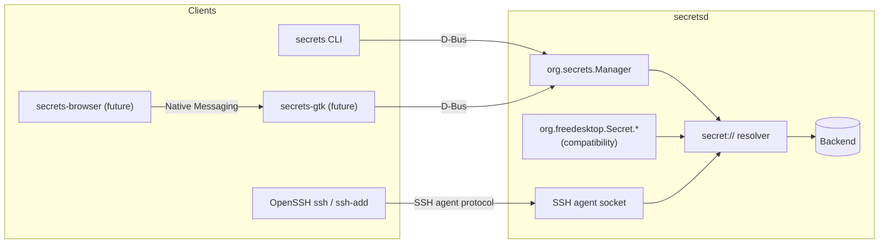

<p align="center">
  
</p>

<h1 align="center">secrets</h1>

<p align="center"><strong>Local-first secret broker and secret manager for Linux desktops</strong></p>

<p align="center">
  <a href="https://github.com/noirbizarre/secrets/actions/workflows/ci.yaml">
    
  </a>
  <a href="https://codecov.io/gh/noirbizarre/secrets">
    
  </a>
  
  <a href="https://noirbizarre.github.io/secrets/">
    
  </a>
  
</p>

---

Every Linux desktop ends up with secrets scattered across a dozen
incompatible places: a password manager's own vault, `~/.ssh/`, a browser's
built-in store, environment variables exported from a shell profile,
plaintext files nobody remembers to `.gitignore`. Each tool that wants a
secret invents its own way to ask for one. **Secrets** is a local-first
secret broker: one user-session daemon (`secretsd`) that owns the actual
secret store and the access control, and a stable local interface —
D-Bus — that any client speaks. The storage backend behind it is
replaceable; the interface is not. Secrets is not another password-manager
UI — it is the plumbing other tools use to reach one.



## `secretsd` and `secrets`

- **`secretsd`** is a user systemd service. It owns the secret store,
  session/lock state, and speaks three protocols on behalf of everything
  else: the native `org.secrets.Manager` D-Bus API, the
  [Secret Service](https://specifications.freedesktop.org/secret-service/)
  D-Bus compatibility interfaces, and the standard SSH agent protocol.
- **`secrets`** is the CLI: a thin client that never holds its own vault or
  session state, only D-Bus calls into `secretsd`.

Secrets are addressed by a `secret://<vault>/<item>/<field>` URI — see
[`docs/secret-uri.md`](docs/secret-uri.md). That scheme is the *resource
reference*; D-Bus is the *transport*. The two answer different questions,
and the documentation treats them as such.

## Installation

Or download a binary for your platform from the
[latest release](https://github.com/noirbizarre/secrets/releases/latest).

## Usage

```bash
secretsd &                        # or: systemctl --user enable --now secretsd
secrets status                    # locked
secrets unlock                    # prompts for a passphrase
secrets list                      # Personal, Infrastructure, ...
secrets list Personal             # GitHub
secrets get secret://Personal/GitHub/password
secrets lock

SSH_AUTH_SOCK=$XDG_RUNTIME_DIR/secrets/ssh-agent.sock ssh-add -L
```

## Current MVP scope

- One backend: a local, AES-256-GCM-encrypted file
  (see [`docs/security.md`](docs/security.md)).
- Two states: locked and unlocked, daemon-wide (no per-vault locking yet).
- Secret Service compatibility covers the "plain" session algorithm only.
- `secrets inject`, `secrets run` and `secrets totp` exist as a CLI surface
  (see `secrets --help`) but are not implemented yet.
- No GTK or browser client yet — see
  [`docs/architecture/clients.md`](docs/architecture/clients.md) for how
  they will attach once they exist.

Full roadmap, tracked by category with checkboxes: [`PLAN.md`](PLAN.md).
Design rationale for every non-obvious decision: [`docs/adr/`](docs/adr/).

## Future backends

The `Backend` trait (`crates/secrets-core/src/backend.rs`) is deliberately
small so more implementations can be added without touching `secretsd`'s
D-Bus surface: Vaultwarden and Bitwarden (API-based), 1Password
(API-based), and `pass`/`gopass`/`passage` (GPG- or age-encrypted files on
disk) are the tracked candidates — see `PLAN.md` §7.

## Documentation

<https://noirbizarre.github.io/secrets/>

- [`secret://` URI scheme](docs/secret-uri.md)
- [Architecture overview](docs/architecture/overview.md)
- [Future clients (GTK, browser)](docs/architecture/clients.md)
- [`org.secrets.Manager` D-Bus API](docs/dbus/secrets-manager.md)
- [Secret Service compatibility](docs/dbus/secret-service.md)
- [SSH agent](docs/dbus/ssh-agent.md)
- [Security model](docs/security.md)

## Contributing

See [CONTRIBUTING.md](CONTRIBUTING.md).

## License

MIT — see [LICENSE](LICENSE).
