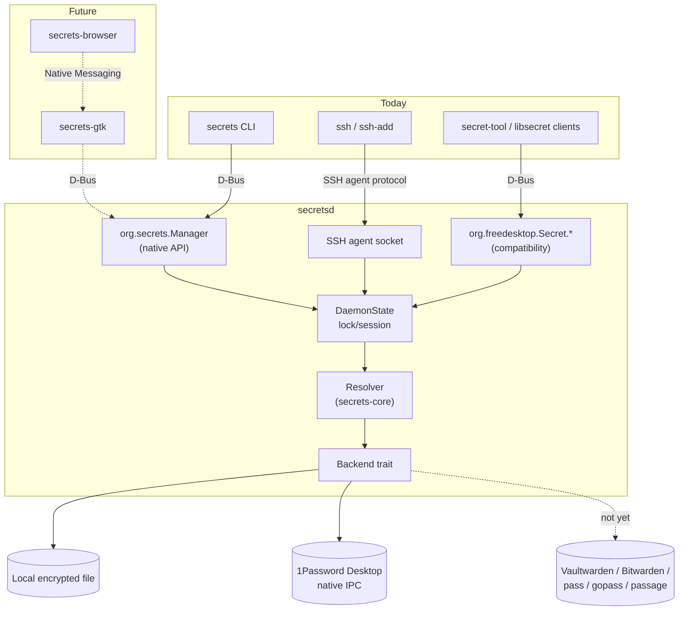

# Architecture overview

Secrets is a local secret broker: one daemon owns the secret store and
access control, and a stable local interface — D-Bus — is how everything
else reaches it. `secret://` is the *resource reference* (see
[secret-uri.md](../secret-uri.md)); D-Bus is the *transport*. The
underlying storage backend is replaceable and never assumed by clients.

## Layers

1. **`secret://` URI** (`secrets-core::uri`) — parses and validates a
   reference into `vault`, `item` (one or more path segments) and `field`.
   Reused by every crate; never reimplemented per client.
2. **Resolver** (`secrets-core::resolver`) — turns a parsed `SecretUri`
   into a value via a `Backend`. Knows nothing about D-Bus, locking, or
   sessions.
3. **Backend** (`secrets-core::backend`) — the contract a storage
   implementation satisfies: `list_vaults`, `list_items`, `get_field`.
   Deliberately small and read-only; see
   [ADR-008](../adr/008-backend-abstraction-and-roadmap.md). A second,
   optional trait, `BackendSession`, lets a backend report its own
   authentication/session state, distinct from `DaemonState`'s daemon-wide
   lock — see [ADR-011](../adr/011-backend-session-and-authentication-state.md).
   Two implementations exist: the local encrypted file, and 1Password
   Desktop's native IPC channel (not the `op` CLI) — see
   [ADR-012](../adr/012-1password-desktop-backend.md),
   [1password-integration.md](1password-integration.md) and
   [1password-poc-results.md](1password-poc-results.md) for the
   investigation and validation behind it.
4. **`secretsd`** — the daemon. Owns `DaemonState` (session/lock — see
   [ADR-009](../adr/009-session-and-lock-state-machine.md)),
   configuration-selected backend (`[backend] type = "local" |
   "1password"` — see [config.rs](../../crates/secretsd/src/config.rs)),
   and three protocol surfaces: `org.secrets.Manager`
   ([ADR-005](../adr/005-native-manager-api-design.md)), the Secret
   Service compatibility interfaces
   ([ADR-004](../adr/004-secret-service-compatibility-scope.md)), and the
   SSH agent ([ADR-007](../adr/007-ssh-agent-implementation.md)).
5. **Clients** — `secrets-cli` today
   ([ADR-010](../adr/010-cli-as-thin-dbus-client.md)); `secrets-gtk` and a
   browser native messaging host in the future (see
   [clients.md](clients.md)); any Secret-Service-speaking application
   (`secret-tool`, `libsecret` consumers) today, read-only.

## Crates

See [ADR-003](../adr/003-workspace-and-crate-boundaries.md) for the
reasoning; in short:

| Crate                | Role                                             |
| --------------------- | ------------------------------------------------ |
| `crates/secrets-core` | Shared library: URI parsing, model, backend trait, D-Bus definitions |
| `crates/secretsd`     | The daemon binary                                |
| `crates/secrets-cli`  | The `secrets` CLI binary                         |

Dependencies point one way: `secretsd` and `secrets-cli` both depend on
`secrets-core`; neither depends on the other.
